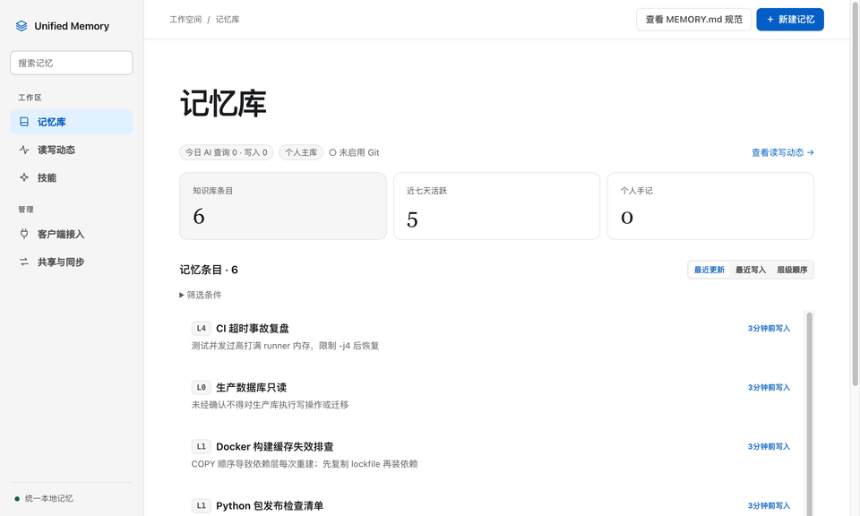
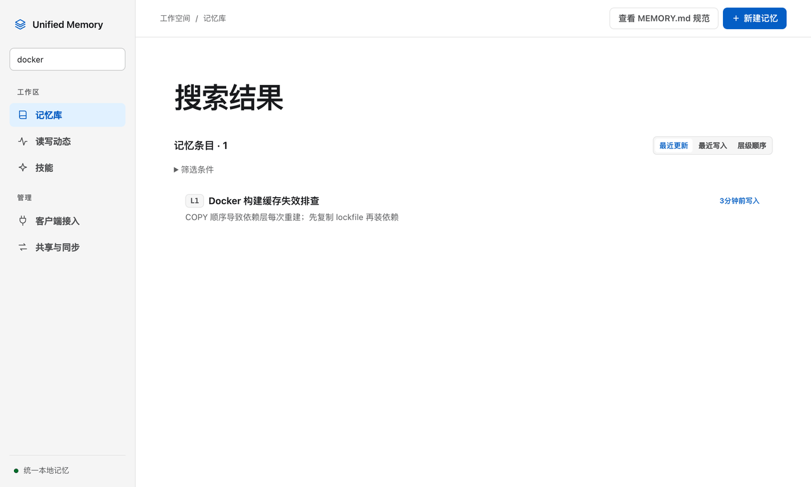
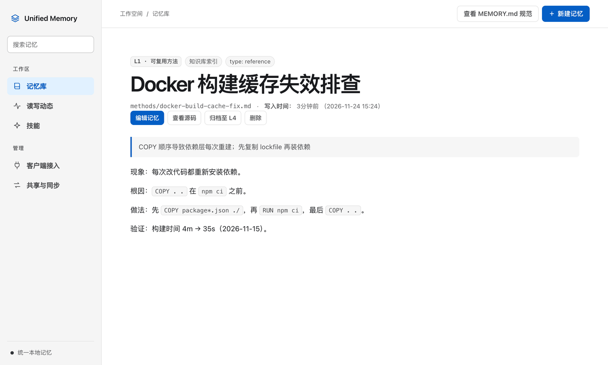
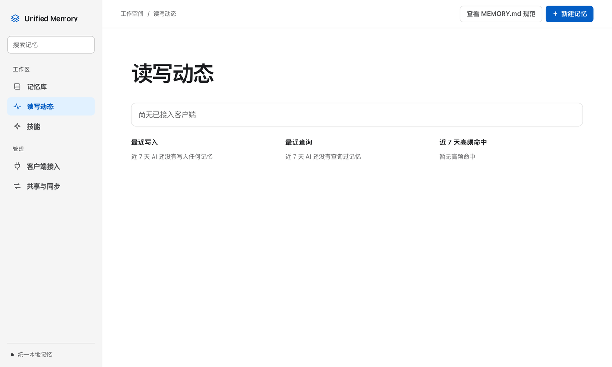
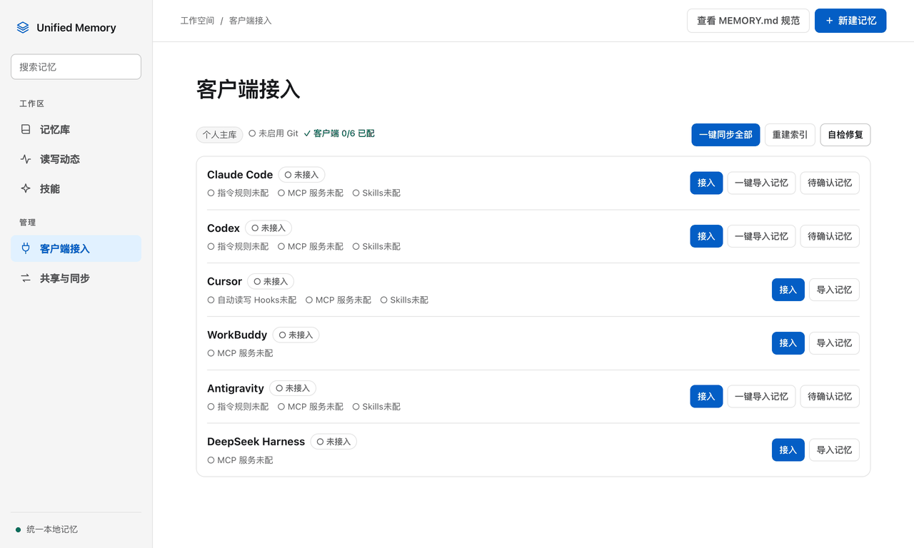

# Unified Memory

Local Markdown memory for AI coding agents. Claude Code, Codex, Cursor, WorkBuddy, Antigravity and DeepSeek Harness read and write the same library through a local MCP server. Entries are plain Markdown files in five layers (L0 constraints, L1 methods, L2 preferences, L3 project snapshots, L4 archive). You can search them in Chinese or English, edit them in the desktop app, and sync them through your own Git repository. Nothing leaves your machine unless you set up sync. The desktop app only asks GitHub for the latest release tag once a day; you can turn this off in the app menu.



### Quick start (macOS, Apple silicon)

1. Download `Unified-Memory-macOS-arm64.zip` from the [latest release](https://github.com/chenwenxinqaq/baton/releases/latest), unzip it and move **Unified Memory.app** to Applications.
2. Open the app. It creates your personal library at `~/UnifiedMemory`.
3. Open 客户端接入 (Clients), click 接入 (Connect) for each agent you use, then restart that agent and ask it to "search my memory with Unified Memory".

On Linux, or without the desktop app, use `unified-memory-cli.tar.gz` from the same release (Python 3.9+ and Git, see below). The desktop UI is currently Chinese only.

| Search | Entry detail |
| --- | --- |
|  |  |
| **Read/write activity** | **Client setup** |
|  |  |

Screenshots use a demo library with sample entries.

## 中文说明

用一套 Markdown 记忆库为 Claude Code、Codex、Cursor、WorkBuddy、Antigravity 和 DeepSeek Harness 提供上下文。框架包含本地 MCP 服务、中文全文与时间检索、Web 编辑和归档、技能管理、客户端接入与配置恢复。需要 macOS 或 Linux、Python 3.9 以上，仅使用标准库。

## 桌面版和命令行版

macOS 桌面版使用 Electron。Apple 芯片发行包为 `Unified-Memory-macOS-arm64.zip`。先将解压出的 **Unified Memory.app** 移到用户的 Applications 目录，再打开。应用内置 Python、Git 和 Git Credential Manager，首次打开会初始化个人库。侧栏提供记忆检索、技能、读写动态、客户端接入和共享同步。在「客户端接入」里可以选择要配置的客户端。

独立命令行包为 `unified-memory-cli.tar.gz`，适用于有 Python 3.9+ 和 Git 的 macOS / Linux。解压到固定目录后运行：

```sh
cd unified-memory-cli
./bin/umem init
./bin/umem list
./bin/umem search "部署"
./bin/umem doctor
./bin/umem upgrade --check
```

`umem read` 接受上一条结果的 `ref`。`umem write --help` 给出写入所需字段，可用 `--body` 或 `--body-file -` 传入 Markdown。独立安装的 CLI 包可随时运行 `umem version` 查看版本、运行 `umem upgrade` 经 SHA-256 校验与自检后原地原子升级（桌面版自带的 CLI 或 Git 源码仓库会被自动保护，避免误覆盖）。把 `bin/umem` 链接到 PATH 中的个人 bin 目录即可从任何目录调用。独立使用 CLI 时，GitHub HTTPS 浏览器登录需要可在 PATH 中找到的 Git Credential Manager，或已安装到 Applications 的桌面版。已有 Git 凭据也可继续使用。

桌面版会常驻 macOS 菜单栏：关闭窗口不会退出，菜单栏图标可打开读写动态、共享与同步，并提供「开机自动启动」开关（首次打开会询问一次）。

### 稳定入口

客户端的 MCP 与 Hook 配置不会直接指向源码目录或 `.app` 包内部，而是指向固定启动器 `~/Library/Application Support/Unified Memory/bin/`（Linux 为 `~/.local/share/unified-memory/bin/`）下的 `umem-mcp`、`umem-hook`、`umem`。启动器由 `memoryctl connect`、桌面版每次启动或 `memoryctl install-shims` 自动刷新；应用被移动或升级后，若记录的运行时已消失，启动器会回退到 `~/Applications`、`/Applications` 里的应用包，仍找不到则明确报错而不是静默失效。旧版直接写入 python 与 `server.py` 路径的配置会被识别为「待同步」，点「同步」即可迁移。

两个入口默认读取 `~/UnifiedMemory`。桌面窗口单独分配回环端口，原有的 8765 网页可以继续使用。已有 CLI 源码安装的用户，可在 macOS 的 `~/Library/Application Support/Unified Memory/backend.json` 配置 `framework` 和 `python` 两个绝对路径，让应用沿用同一份已升级的源码和解释器；新安装默认使用包内运行时。

### 本地构建

在 Apple 芯片 Mac 上用 Node.js 22.12+、npm、Python 3 和 macOS 命令行工具构建。源码开发使用 `cd desktop && npm ci && npm start`。在同一目录运行 `npm run package` 可生成桌面 ZIP 及 `.sha256` 校验文件。构建脚本校验 Python 和 [Dugite Native v2.56.1](https://github.com/desktop/dugite-native/tree/v2.56.1) 发行包的 SHA-256，首次构建需要联网。Dugite 提供 Git 和 [Git Credential Manager](https://github.com/git-ecosystem/git-credential-manager/tree/v2.9.1)，许可证位于应用的 `Contents/Resources/licenses`。另可提供同架构的可迁移运行时目录 `UMEM_PYTHON_DIST`。桌面产物为本地 ad-hoc 签名；正式面向公众分发还需 Developer ID 签名和 Apple 公证。

桌面版内置应用内更新器（不使用会拒绝 ad-hoc 签名的 Squirrel.Mac）：打包后的应用每天检查一次 GitHub 最新版本（支持 ETag 缓存与网页发布页降级，避免 60 次/小时的 API 限流）；发现新版后可在窗口顶部更新条或菜单栏一键下载，自动校验 SHA-256、`CFBundleIdentifier`、版本号、`codesign --verify --deep --strict` 与内嵌运行环境，并在退出后原子替换当前 `.app`（异常自动回滚）、重启并运行 `umem doctor --fix` 刷新启动器与客户端规则。若应用运行在只读磁盘镜像、App Translocation 隔离路径或无写权限目录，会自动提示原因并提供发布页手动下载入口。可在应用菜单关闭「自动检查更新」，或随时点「检查更新…」。

在仓库根目录运行 `python3 scripts/package_release.py --cli` 单独生成 CLI 包。两个发行包都位于 `dist/`。分发内容来自公开文件清单。

## 框架与数据

本仓库保存程序、空模板、通用记忆技能和合成数据测试。使用者的索引、条目和运行状态保存在单独的数据目录。可将同一份代码与不同的数据目录配合使用。

| 公开源码 | 每位使用者的私有数据目录 |
| --- | --- |
| `mcp/`、`manager/`、`scripts/` | `MEMORY.md` 和 L0–L4 五个条目目录 |
| `templates/`、内置的 `skills/unified-memory/` | `user-managed/` 和使用者自己的 `skills/` |
| `tests/` 及其虚构样本 | 本机运行状态位于 `~/.local/state/unified-memory/`（锁、回收站、恢复信息），不污染记忆仓库 |

## 从空库开始

在源码目录运行。默认数据位置为 `~/UnifiedMemory`，也可以预先设置 `UNIFIED_MEMORY_ROOT` 指向仓库之外的目录。命令行和管理页需要使用相同的环境变量。

```sh
export UNIFIED_MEMORY_ROOT="$HOME/my-private-memory"
python3 scripts/memoryctl.py init
python3 scripts/memoryctl.py doctor
python3 manager/manager.py
```

打开 http://127.0.0.1:8765/ ，新建一条 L1 方法并搜索标题。初始化可重复执行，已存在的索引和技能会保留。导入已有同格式库时直接指定其根目录，运行 doctor 检查索引。

## Agent 如何决定写什么

公开版的写入规约位于 [空库模板的 §0](templates/library.md)。它规定何时保存、何时跳过、如何选择 L0–L4、怎样合并已有主题，以及何时撤回或归档旧结论。`init` 把规约和三份条目模板放进新库。`connect` 将同一份公开规约写入 Claude Code、Codex 和 Antigravity 各自的接入指令。Cursor 通过全局 MCP 配置和本地技能目录接入。接入时只读取公开模板，个人索引和正文留在私有库。

从早期公开版升级时，在原数据目录配置下重跑 `init` 补齐缺少的模板，再对已接入的客户端重跑 `connect` 并重开会话。新规约随客户端指令生效，已有私有索引和自定义模板会保留。

## 接入客户端

### 导入客户端已有记忆

打开「客户端接入」，在客户端对应行使用「一键导入记忆」或「待确认与导入」。接入保留客户端自己的记忆设置。旧版本曾关闭 Codex 记忆时，「同步」可恢复仍由旧版管理的设置。

| 客户端 | 导入来源 |
| --- | --- |
| Codex | 自动读取 v1/v2 本地会话记忆和摘要，按会话去重。仅保留汇总时可导入汇总。 |
| Claude Code | 自动读取本机各项目的 Auto Memory，以及用户设置中指定的 `autoMemoryDirectory`。 |
| Antigravity | 自动读取本机 Antigravity 和 Antigravity IDE 的 `knowledge/` Markdown。 |
| Cursor | 粘贴「设置 → Rules」里保存的记忆，或选择想导入的 `.mdc` 文件。 |
| WorkBuddy | 粘贴「设置 → 记忆与进化」的内容，或选择工作空间的 `MEMORY.md`。 |
| DeepSeek Harness | 选择已有的记忆文件或粘贴内容，审核后归层。 |

五个客户端都可导入 UTF-8 的 Markdown 或纯文本。待确认的副本留在本机，支持按来源搜索。核对原文并选定 L0–L4 后，点「确认归入所选层」写入个人库。此时该条才进入普通搜索和个人库 Git 同步。

命令行可以运行 `umem import-memory codex`、`umem import-memory claude` 或 `umem import-memory antigravity` 扫描本机。选择文件时用 `umem import-memory cursor --file memory.md`，客户端名称可换成表中任意一项对应的 `codex`、`claude`、`cursor`、`workbuddy`、`antigravity` 或 `deepseek`。归层在管理页完成。

### DeepSeek Harness

在「客户端接入」的 DeepSeek Harness 卡片点「接入」，或运行 `umem connect deepseek`。应用通过官方 `@deepseek-ai/dsh-mcp-client` 把本地记忆服务加到 `~/.dsh/cordis.patch.yml`，已有插件配置会保留。Harness 使用自定义 `DSH_HOME` 时，请用同一个环境变量运行 `umem connect deepseek` 和 `umem disconnect deepseek`。重启 Harness 后，在新会话输入「用 Unified Memory 搜索我的记忆」，回到「读写动态」核对调用。可从同一卡片断开。 [DeepSeek Harness 官方记忆 MCP 指南](https://github.com/deepseek-ai/deepseek-harness/blob/master/docs/user/guide/mcp-memory.zh.md)

### Claude Desktop

使用 Claude 桌面版（包括标准版 `Claude` 与 `Claude-3p`）时，打开 Unified Memory 的「客户端接入」，在 Claude Desktop 一行点「接入」，或运行 `umem connect claude-desktop`。应用会将 `unified-memory` 合并到 `claude_desktop_config.json`（macOS 自动识别 `~/Library/Application Support/Claude/` 或 `Claude-3p/`，也可用 `CLAUDE_DESKTOP_CONFIG` 显式指定路径），已有配置会保留。重启 Claude Desktop 后，在新会话中即可使用 Unified Memory，可从同一行断开。

### WorkBuddy 和其他客户端

使用腾讯 WorkBuddy 桌面版时，打开 Unified Memory 的「客户端接入」，在 WorkBuddy 一行点「接入」。应用将 `unified_memory` 合并到用户级 `~/.workbuddy/mcp.json`，其他项目也能使用。命令行等价操作为 `umem connect workbuddy`。在 WorkBuddy 会话中输入「用 unified_memory 搜索我的记忆」，即可在「读写动态」核对实际调用。可从同一行断开。[WorkBuddy 官方 MCP 配置说明](https://www.codebuddy.cn/docs/workbuddy/From-Beginner-to-Expert-Guide/Function-Description/MCP-Guide)

以下以 Codex 为例。接入会更新该客户端的指令与 MCP 配置，命令指向本机的稳定启动器，参数指向当前选定的数据目录。客户端重新启动后能继续找到该库。

```sh
python3 scripts/memoryctl.py connect codex --dry-run
python3 scripts/memoryctl.py connect codex
```

需要解除接入时，在相同数据目录配置下运行 `python3 scripts/memoryctl.py disconnect codex`。更换数据目录时先解除旧接入。自己的技能放在数据目录的 `skills/<名称>/SKILL.md`，可通过管理页或 CLI 启用、停用和同步。

技能使用的共享文档也可以留在私有库。例如在 `skills/resources.json` 写入 `{"report-helper": ["shared-guides"]}`，并在 `skills/shared-guides/` 放置文档。启用 report-helper 时，客户端会同步挂载该资源目录。多个技能可以引用同一资源。

## 多设备与团队共享（Git 同步与多库挂载）

支持将个人库绑定到私有 Git 仓库（GitHub / Gitee / 自建 Gitea 等）实现多设备同步，同时按库挂载只读（`ro`）或共写（`rw`）的团队共享库。共享库默认仅开放 `L1 / L3 / L4`，不会改写本机 `L0` 红线与 `L2` 个人偏好。

**第一次用桌面版同步 GitHub**

- 备份自己的记忆时，在「共享与同步 → 个人主库跨设备同步」粘贴自己有写权限的仓库 HTTPS 地址，点「连接并同步」。已绑定的库点「立即同步」。首次需要凭据时，按系统浏览器的 GitHub 授权提示操作，回到应用看结果。后续同步可复用 macOS 钥匙串中的凭据。新设备上的默认空库也能直接接入自己已有的远端记忆库。
- 加入已有团队库时，先用自己的 GitHub 账号接受仓库邀请，再到「挂载新的共享记忆库」粘贴团队仓库 HTTPS 地址，选择只读或共写。应用将它克隆到独立目录，个人记忆仍在个人库中。向团队仓库推送需要 GitHub 写权限。
- 想先确认能否访问，可以先「仅保存地址」，再点库卡片上的「连接 GitHub（仅验证）」。这一步只读取远端引用。

```sh
# 1. 为个人主库绑定私有 Git 远端并同步
python3 scripts/memoryctl.py sync setup personal --remote-url https://github.com/you/my-memory.git
python3 scripts/memoryctl.py sync run personal

# 2. 挂载团队共享库（支持自动克隆，按需选 ro 或 rw）
python3 scripts/memoryctl.py mount add team-kb --path ~/UnifiedMemory-Team --label "研发共享库" --mode rw --git git@gitee.com:team/memory-kb.git
python3 scripts/memoryctl.py sync run all
```

也可以直接在 Web 管理页顶部点击「共享与同步」图形化配置远端、增删共享库，或在条目页一键将个人记忆分享到共享库；多端同时改同一篇条目时，系统会保留冲突副本并在管理页提供行级 Diff 对比与一键合并。

## 验证与分发

运行 `python3 -m unittest discover -s tests -v`。回归测试在临时目录生成样本，并为客户端配置使用独立的临时 HOME。

发布源码仓库或从该仓库打包。备份个人记忆时备份数据目录。模板中写入示范格式，测试中使用虚构数据。

运行 `python3 scripts/package_release.py` 生成 `unified-memory-starter.zip`。打包脚本仅从源码根目录逐个读取清单中的文件，新增公开组件时同步更新清单。
